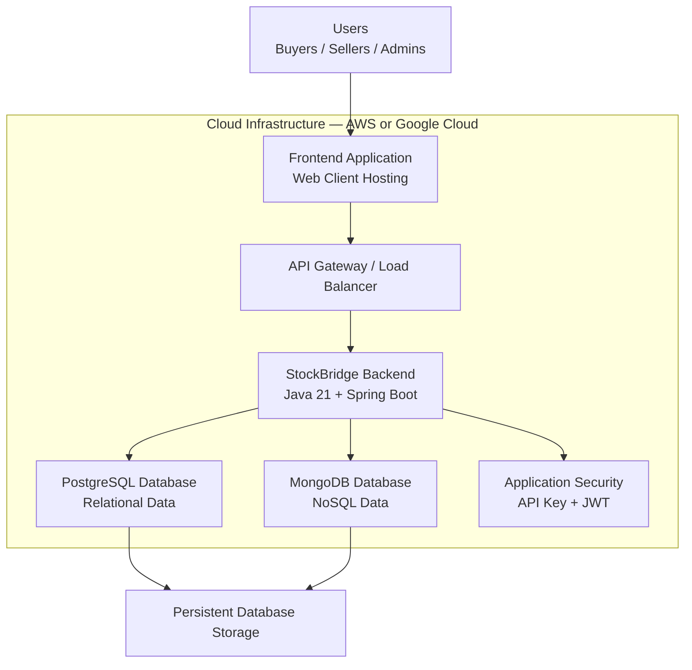

# StockBridge Backend

A Spring Boot REST API powering **StockBridge**, a B2B surplus inventory marketplace designed to connect manufacturers, distributors, wholesalers, and retailers.

StockBridge aims to help businesses turn surplus and slow-moving inventory into working capital by providing a platform for discovering, managing, and exchanging available stock.

---

## 1. Project Overview

StockBridge Backend is the server-side application responsible for handling business logic, authentication, authorization, inventory-related operations, data persistence, and communication with the frontend.

The backend is built using Java 21 and Spring Boot 3.4.3. It follows a REST API architecture and integrates PostgreSQL and MongoDB for data storage.

### Key objectives

- Provide RESTful APIs for frontend applications.
- Support secure user authentication and authorization.
- Manage application data using PostgreSQL and MongoDB.
- Protect sensitive endpoints using API-key and JWT-based security.
- Validate incoming requests.
- Apply rate limiting to selected authentication endpoints.
- Support database schema management through Flyway.
- Provide API documentation during development.
- Support containerized local database services through Docker Compose.

### Main technologies

| Component | Technology |
|---|---|
| Programming language | Java 21 |
| Backend framework | Spring Boot 3.4.3 |
| Build tool | Maven Wrapper |
| Relational database | PostgreSQL 16 |
| NoSQL database | MongoDB |
| ORM | Spring Data JPA / Hibernate |
| Database migrations | Flyway |
| Authentication | JWT |
| API security | Spring Security |
| Rate limiting | Bucket4j |
| API documentation | SpringDoc OpenAPI |
| Monitoring | Spring Boot Actuator |
| Containerization | Docker / Docker Compose |

---

## 2. System Architecture

StockBridge Backend follows a REST-based client-server architecture.

The frontend communicates with the backend through HTTP requests. The backend processes requests, applies security checks, executes business logic, and interacts with the configured databases.

### High-level architecture

```text
                 CLIENT APPLICATION
                         |
                         |
                    HTTP / HTTPS
                         |
                         v
                SPRING BOOT BACKEND
                         |
              -----------------------
              |                     |
              v                     v
         SECURITY LAYER        API CONTROLLERS
              |                     |
              |                     v
              |                SERVICE LAYER
              |                     |
              |                     v
              |              REPOSITORY LAYER
              |                     |
              -----------------------
                         |
              -----------------------
              |                     |
              v                     v
          POSTGRESQL             MONGODB
          Database               Database
```

### Backend responsibilities

**Controller layer**

- Receives HTTP requests.
- Handles API request mappings.
- Returns HTTP responses.
- Delegates business operations to the appropriate application components.

**Service layer**

- Contains application and business logic.
- Coordinates operations between application components.
- Applies business rules before interacting with persistence components.

**Repository layer**

- Handles database access.
- Uses Spring Data JPA for relational persistence.
- Supports MongoDB integration through Spring Data MongoDB.

**Security layer**

- Processes API-key validation.
- Applies request rate limiting to selected authentication endpoints.
- Validates JWT tokens for protected endpoints.
- Applies Spring Security authorization rules.

> The exact package structure and responsibilities should be confirmed against the current source code before adding class-specific architecture diagrams.

### Cloud-Based Deployment Architecture

The StockBridge platform is designed around a client-server architecture in which the frontend, backend, cloud infrastructure, and databases work together to provide a complete B2B marketplace experience.

The proposed architecture supports deployment using either **Amazon Web Services (AWS)** or **Google Cloud Platform (GCP)**.

#### Proposed architecture diagram



#### Architecture components

| Component | Responsibility |
|---|---|
| Users | Buyers, sellers, and administrators access the marketplace |
| Frontend | Provides the user interface and communicates with backend APIs |
| Cloud Infrastructure | Hosts and manages the application services |
| API Gateway / Load Balancer | Provides an entry point for routing frontend requests to the backend |
| Backend | Handles business logic, authentication, authorization, and API processing |
| PostgreSQL | Stores structured relational application data |
| MongoDB | Provides NoSQL data storage |
| Persistent Storage | Supports database data persistence |
| Application Security | Protects API access through configured security mechanisms |

#### Potential cloud provider implementation

The architecture can be implemented using either of the following cloud providers:

**Option A: Amazon Web Services (AWS)**

| Architecture Component | Potential AWS Service |
|---|---|
| Frontend Hosting | AWS Amplify or Amazon S3 with CloudFront |
| API Entry Point | Amazon API Gateway or Application Load Balancer |
| Backend Hosting | Amazon ECS, AWS App Runner, or Amazon EC2 |
| PostgreSQL | Amazon RDS for PostgreSQL |
| MongoDB | MongoDB Atlas hosted on AWS |
| Security and Secrets | AWS IAM and AWS Secrets Manager |
| Monitoring | Amazon CloudWatch |

**Option B: Google Cloud Platform (GCP)**

| Architecture Component | Potential GCP Service |
|---|---|
| Frontend Hosting | Firebase Hosting or Google Cloud Storage with Cloud CDN |
| API Entry Point | Google Cloud API Gateway or Cloud Load Balancing |
| Backend Hosting | Google Cloud Run or Google Compute Engine |
| PostgreSQL | Google Cloud SQL for PostgreSQL |
| MongoDB | MongoDB Atlas hosted on GCP |
| Security and Secrets | IAM and Secret Manager |
| Monitoring | Google Cloud Monitoring and Logging |

*These are possible service mappings, not a declaration that the project has already been deployed on either provider. The final provider and services depend on deployment requirements.*

#### Data flow

1. A user accesses StockBridge through the frontend application.
2. The frontend sends HTTP requests to the backend through the configured API entry point.
3. The backend processes incoming requests and applies authentication and authorization.
4. Business logic is executed by the backend services.
5. The backend communicates with PostgreSQL and MongoDB as required.
6. Database responses are processed by the backend.
7. The backend returns an appropriate HTTP response to the frontend.
8. The frontend displays the resulting information to the user.

#### Architecture design objectives

- Separation of frontend and backend responsibilities.
- Centralized backend API communication.
- Independent database services for relational and NoSQL workloads.
- Secure communication between application components.
- Cloud deployment flexibility between AWS and GCP.
- Persistent database storage.
- Scalability and maintainability as the platform grows.

**Architecture status:** Proposed cloud deployment design. Actual cloud provider selection and deployment should be documented once implemented.

---

## 3. Technology Stack

### Backend development

| Technology | Purpose |
|---|---|
| Java 21 LTS | Primary programming language |
| Spring Boot 3.4.3 | Backend application framework |
| Spring Web | REST API development |
| Spring Security | Authentication and authorization |
| Spring Data JPA | Relational database access |
| Spring Data MongoDB | MongoDB integration |
| Hibernate | ORM implementation |
| Jakarta Validation | Request and data validation |
| Lombok | Reducing repetitive Java code |
| Spring Boot DevTools | Development-time support |

### Database and persistence

| Technology | Purpose |
|---|---|
| PostgreSQL 16 | Relational data storage |
| MongoDB | NoSQL data storage |
| Flyway | Database schema migrations |
| Hibernate | Entity persistence and ORM |

### Security

| Technology | Purpose |
|---|---|
| Spring Security | Security framework |
| JWT | Token-based authentication |
| API Key Filter | API-key validation |
| Bucket4j | Request rate limiting |
| CORS | Cross-origin request configuration |

### API documentation and monitoring

| Technology | Purpose |
|---|---|
| SpringDoc OpenAPI | OpenAPI documentation |
| Swagger UI | Interactive API documentation |
| Spring Boot Actuator | Application health monitoring |

### Build and deployment

| Technology | Purpose |
|---|---|
| Maven Wrapper | Consistent Maven builds |
| Docker | Containerization |
| Docker Compose | Local database services |
| Git | Version control |
| GitHub | Source-code hosting and collaboration |

---

## 4. Project Structure

The backend follows the standard Maven and Spring Boot project layout.

```text
StockBridgeBack/
│
├── src/
│   ├── main/
│   │   ├── java/
│   │   │   └── [application packages]/
│   │   │
│   │   └── resources/
│   │       ├── application.yml
│   │       ├── application-dev.yml
│   │       ├── application-prod.yml
│   │       │
│   │       ├── db/
│   │       │   └── migration/
│   │       │
│   │       └── META-INF/
│   │
│   └── test/
│       └── java/
│           └── [test packages]/
│
├── .mvn/
│   └── wrapper/
│
├── .env.example
├── .gitignore
├── Dockerfile
├── docker-compose.yml
├── mvnw
├── mvnw.cmd
├── pom.xml
└── README.md
```

### Important files

| File | Description |
|---|---|
| `pom.xml` | Maven dependencies, plugins, and Java version |
| `mvnw` | Maven Wrapper for Linux and macOS |
| `mvnw.cmd` | Maven Wrapper for Windows |
| `Dockerfile` | Backend container build instructions |
| `docker-compose.yml` | Local database service configuration |
| `.env.example` | Example environment configuration |
| `application.yml` | Shared application configuration |
| `application-dev.yml` | Development profile configuration |
| `application-prod.yml` | Production profile configuration |
| `db/migration/` | Flyway database migration scripts |

---

## 5. Prerequisites

Before running the backend, install the following software.

| Requirement | Version / Configuration |
|---|---|
| Java JDK | 21 |
| Maven | Maven Wrapper included |
| PostgreSQL | 16 |
| MongoDB | 8-compatible local service |
| Docker Engine | Recommended for local databases |
| Docker Compose | Required for Compose-based database startup |
| Git | Latest stable version |

### Verify installations

Check Java:

```bash
java -version
```

Check Git:

```bash
git --version
```

Check Docker:

```bash
docker --version
```

Check Docker Compose:

```bash
docker compose version
```

The project includes Maven Wrapper scripts, so a separate global Maven installation is not required.

---

## 6. Fedora Linux Setup

These instructions are intended for Fedora Linux users.

### 6.1 Install Java 21

Install the Java development kit:

```bash
sudo dnf install java-21-openjdk-devel
```

Verify the installation:

```bash
java -version
javac -version
```

The application targets Java 21.

If multiple Java versions are installed, ensure that Java 21 is selected for the current terminal session.

### 6.2 Install Git

```bash
sudo dnf install git
```

Verify:

```bash
git --version
```

### 6.3 Clone the repository

```bash
git clone https://github.com/Rudra3p/StockBridgeBack.git
```

Move into the project directory:

```bash
cd StockBridgeBack
```

### 6.4 Make Maven Wrapper executable

```bash
chmod +x mvnw
```

Verify:

```bash
./mvnw --version
```

### 6.5 Start database services

Docker Engine and Docker Compose must be installed and running.

Start Docker if necessary:

```bash
sudo systemctl enable --now docker
```

If your Docker installation requires elevated permissions, prefix Docker commands with `sudo`.

Start the database containers:

```bash
docker compose up -d
```

Check running containers:

```bash
docker compose ps
```

Check container logs:

```bash
docker compose logs
```

---

## 7. Windows Setup

These instructions are intended for Windows 10 and Windows 11.

### 7.1 Install Java 21

Install a Java 21 JDK distribution, such as Eclipse Temurin 21.

Verify the installation in PowerShell:

```powershell
java -version
javac -version
```

### 7.2 Install Git

Install Git for Windows.

Verify:

```powershell
git --version
```

### 7.3 Install Docker Desktop

Install Docker Desktop and ensure that its Docker Engine is running.

Verify:

```powershell
docker --version
docker compose version
```

### 7.4 Clone the repository

```powershell
git clone https://github.com/Rudra3p/StockBridgeBack.git
```

Move into the project directory:

```powershell
cd StockBridgeBack
```

### 7.5 Start database services

```powershell
docker compose up -d
```

Verify:

```powershell
docker compose ps
```

### 7.6 Run the backend

Use the Windows Maven Wrapper:

```powershell
.\mvnw.cmd spring-boot:run
```

---

## 8. Database Setup

StockBridge Backend integrates PostgreSQL and MongoDB.

The provided Docker Compose configuration can be used to start both database services locally.

### 8.1 PostgreSQL

Configuration used by the local Docker Compose setup:

| Setting | Value |
|---|---|
| Docker image | `postgres:16-alpine` |
| Container name | `stockbridge-postgres` |
| Database | `stockbridge` |
| Username | `stockbridge` |
| Password | `stockbridge` |
| Host | `localhost` |
| Port | `5432` |

PostgreSQL is exposed on the local machine through:

```text
127.0.0.1:5432
```

The database uses a named Docker volume:

```text
postgres_data
```

This allows database data to persist when containers are stopped or recreated.

### 8.2 MongoDB

Configuration used by the local Docker Compose setup:

| Setting | Value |
|---|---|
| Docker image | `mongo:8` |
| Container name | `stockbridge-mongodb` |
| Database | `stockbridge` |
| Host | `localhost` |
| Port | `27017` |

MongoDB is exposed locally through:

```text
127.0.0.1:27017
```

The database uses a named Docker volume:

```text
mongodb_data
```

The local Compose configuration does not enable MongoDB authentication. Do not use this local configuration as a production security configuration.

### 8.3 Start the databases

```bash
docker compose up -d
```

### 8.4 Check database containers

```bash
docker compose ps
```

### 8.5 View PostgreSQL logs

```bash
docker compose logs postgres
```

### 8.6 View MongoDB logs

```bash
docker compose logs mongodb
```

### 8.7 Stop database containers

```bash
docker compose down
```

This stops and removes the containers but preserves named volumes.

**Important:** Avoid `docker compose down -v` unless you intentionally want to delete the persistent database volumes and their data.

---

## 9. Application Configuration

The application uses Spring Boot configuration profiles.

The primary configuration files are:

```text
src/main/resources/
│
├── application.yml
├── application-dev.yml
└── application-prod.yml
```

### 9.1 Development profile

The default active profile is:

```text
dev
```

The development configuration is designed for local development.

Default local database configuration:

```text
PostgreSQL:
Host: localhost
Port: 5432
Database: stockbridge
Username: stockbridge
Password: stockbridge

MongoDB:
Host: localhost
Port: 27017
Database: stockbridge
```

### 9.2 Production profile

The production profile is activated using:

```bash
SPRING_PROFILES_ACTIVE=prod
```

Production configuration uses environment variables rather than relying on local development credentials.

### 9.3 Environment variables

The application supports the following configuration variables:

| Variable | Purpose |
|---|---|
| `PORT` | Backend server port |
| `SPRING_PROFILES_ACTIVE` | Active Spring profile |
| `SPRING_DATASOURCE_URL` | Development PostgreSQL JDBC URL |
| `SPRING_DATASOURCE_USERNAME` | Development PostgreSQL username |
| `SPRING_DATASOURCE_PASSWORD` | Development PostgreSQL password |
| `DATABASE_URL` | Production PostgreSQL JDBC URL |
| `DB_USER` | Production database username |
| `DB_PASSWORD` | Production database password |
| `MONGODB_URI` | MongoDB connection URI |
| `MONGODB_DATABASE` | MongoDB database name |
| `BACKEND_API_KEY` | Backend API key |
| `JWT_SECRET` | JWT signing secret |
| `JWT_EXPIRATION_MS` | JWT expiration time in milliseconds |
| `ALLOWED_ORIGINS` | Allowed frontend origins |

### 9.4 Example local environment

The development profile provides local defaults for database connections and selected application settings.

If you want to override them, export the variables in your terminal before starting the backend.

Linux:

```bash
export SPRING_PROFILES_ACTIVE=dev
export SPRING_DATASOURCE_URL=jdbc:postgresql://localhost:5432/stockbridge
export SPRING_DATASOURCE_USERNAME=stockbridge
export SPRING_DATASOURCE_PASSWORD=stockbridge
export MONGODB_URI=mongodb://localhost:27017/stockbridge
export MONGODB_DATABASE=stockbridge
export BACKEND_API_KEY=your-local-development-api-key
```

Windows PowerShell:

```powershell
$env:SPRING_PROFILES_ACTIVE="dev"
$env:SPRING_DATASOURCE_URL="jdbc:postgresql://localhost:5432/stockbridge"
$env:SPRING_DATASOURCE_USERNAME="stockbridge"
$env:SPRING_DATASOURCE_PASSWORD="stockbridge"
$env:MONGODB_URI="mongodb://localhost:27017/stockbridge"
$env:MONGODB_DATABASE="stockbridge"
$env:BACKEND_API_KEY="your-local-development-api-key"
```

### 9.5 Important environment-file note

`.env.example` is an example configuration file.

Copying it to `.env` does not automatically make its variables available to a backend started directly with `./mvnw spring-boot:run`.

Docker Compose reads `.env` for Compose variable interpolation, but a direct Maven launch requires environment variables to be exported into the shell or supplied through another supported configuration mechanism.

Do not commit real passwords, API keys, JWT secrets, or production credentials to GitHub.

---

## 10. Build and Run

### 10.1 Clone the repository

```bash
git clone https://github.com/Rudra3p/StockBridgeBack.git
cd StockBridgeBack
```

### 10.2 Start database services

```bash
docker compose up -d
```

Ensure the containers are running:

```bash
docker compose ps
```

### 10.3 Build the application

Linux:

```bash
chmod +x mvnw
./mvnw clean package
```

Windows:

```powershell
.\mvnw.cmd clean package
```

To build without running tests:

Linux:

```bash
./mvnw clean package -DskipTests
```

Windows:

```powershell
.\mvnw.cmd clean package -DskipTests
```

Skipping tests is useful for a quick compilation and packaging check, but it does not verify application behavior.

### 10.4 Run using Spring Boot Maven Plugin

Linux:

```bash
./mvnw spring-boot:run
```

Windows:

```powershell
.\mvnw.cmd spring-boot:run
```

### 10.5 Run the packaged JAR

After a successful package build:

```bash
java -jar target/backend-0.0.1-SNAPSHOT.jar
```

### 10.6 Default application address

```text
http://localhost:8080
```

The default server port is `8080`, unless overridden through the `PORT` environment variable.

### 10.7 Stop the application

Press:

```text
CTRL + C
```

in the terminal running the backend.

---

## 11. API Documentation

The backend uses SpringDoc OpenAPI for API documentation.

During development, Swagger UI and OpenAPI documentation are enabled.

### Swagger UI

```text
http://localhost:8080/swagger-ui.html
```

### OpenAPI JSON

```text
http://localhost:8080/v3/api-docs
```

Swagger UI provides an interactive interface for exploring documented API operations and testing requests.

### Development and production behavior

| Profile | Swagger UI | OpenAPI |
|---|---|---|
| Development | Enabled | Enabled |
| Production | Disabled | Disabled |

### API request authentication

Depending on the endpoint, requests may require:

- An API key.
- A valid JWT access token.
- Both API-key and JWT authentication, depending on the configured security rules.

Do not assume every endpoint uses the same authentication requirements.

---

## 12. Security Architecture

Security is an important part of the StockBridge backend.

The existing implementation includes API-key validation, JWT-based authentication, Spring Security authorization, CORS configuration, and rate limiting for selected authentication endpoints.

### 12.1 API-key authentication

The API-key filter validates requests using the configured backend API key.

The expected request header is:

```http
X-API-KEY: your-api-key
```

The existing security design requires an API key for `/api/**` requests.

The implementation uses `MessageDigest.isEqual` for API-key comparison.

### 12.2 JWT authentication

JWT is used for stateless token-based authentication.

A JWT can be supplied through the standard authorization header:

```http
Authorization: Bearer YOUR_JWT_TOKEN
```

The backend validates tokens before allowing access to protected endpoints.

JWT configuration includes:

| Variable | Purpose |
|---|---|
| `JWT_SECRET` | Token signing secret |
| `JWT_EXPIRATION_MS` | Token expiration duration |

Never use a weak or publicly exposed JWT secret in production.

### 12.3 Rate limiting

The backend uses Bucket4j for rate limiting.

The existing configuration applies a limit of:

```text
10 requests per minute per IP
```

This protection applies to selected login and registration endpoints.

Rate limiting helps reduce excessive authentication requests and automated abuse.

### 12.4 CORS

Cross-Origin Resource Sharing is configured through:

```text
ALLOWED_ORIGINS
```

The default development frontend origin is:

```text
http://localhost:3000
```

Production deployments should configure the actual frontend origin rather than relying on development defaults.

### 12.5 Security request flow

The existing security design can be represented as:

```text
             INCOMING REQUEST
                     |
                     v
                CORS CHECK
                     |
                     v
               API KEY FILTER
                     |
                     v
             RATE LIMITING FILTER
                     |
                     v
                 JWT FILTER
                     |
                     v
             SPRING SECURITY
                     |
                     v
               API CONTROLLER
```

The exact filter ordering and exception handling should be understood from the configured Spring Security filter chain.

### 12.6 Security recommendations

- Never commit real credentials.
- Use a strong, unique JWT signing secret.
- Keep production secrets outside source control.
- Use HTTPS in production.
- Configure CORS for trusted frontend origins.
- Avoid using development API keys in production.
- Protect database credentials.
- Apply appropriate authorization rules to sensitive operations.
- Keep Java and application dependencies updated.

---

## 13. Database Migrations

StockBridge uses Flyway for database schema versioning and migration management.

Flyway is configured to load migrations from:

```text
src/main/resources/db/migration/
```

The application also uses Hibernate with:

```yaml
spring:
  jpa:
    hibernate:
      ddl-auto: validate
```

This means Hibernate validates the database schema rather than automatically creating or updating it.

### 13.1 Migration workflow

When the application starts:

1. Spring Boot initializes the application.
2. Flyway checks the migration history.
3. Pending migrations are applied.
4. Hibernate validates the entity mappings against the database schema.

### 13.2 Migration naming convention

Flyway versioned migrations conventionally use:

```text
V1__initial_schema.sql
V2__add_inventory_table.sql
V3__update_user_table.sql
```

The exact existing migration filenames should be checked in the migration directory.

### 13.3 Creating a new migration

When a database schema change is required, create a new versioned SQL migration.

For example:

```text
src/main/resources/db/migration/V4__add_new_feature.sql
```

Example SQL:

```sql
CREATE TABLE example_table (
    id BIGSERIAL PRIMARY KEY,
    name VARCHAR(255) NOT NULL
);
```

The example above is illustrative. Actual migrations should match the application's entity definitions and database requirements.

### 13.4 Important migration rules

- Do not casually modify migrations that have already been applied.
- Create a new migration for subsequent schema changes.
- Test migrations against a development database.
- Review SQL changes before committing.
- Keep entity definitions and database schemas consistent.

---

## 14. Testing

The project includes a test source directory and Maven test dependencies.

The configured testing dependencies include:

- Spring Boot Starter Test
- Spring Security Test
- H2 Database for testing

### 14.1 Run all tests

Linux:

```bash
./mvnw test
```

Windows:

```powershell
.\mvnw.cmd test
```

### 14.2 Run a clean test build

Linux:

```bash
./mvnw clean verify
```

Windows:

```powershell
.\mvnw.cmd clean verify
```

### 14.3 Run tests without rebuilding everything

```bash
./mvnw test
```

### 14.4 Test reports

Maven normally generates test reports under:

```text
target/surefire-reports/
```

### 14.5 Testing recommendations

The backend should be tested at multiple levels:

**Unit testing**

- Validate individual methods and business rules.
- Test service-layer logic.
- Test validation and exception handling.

**Integration testing**

- Verify interactions between application components.
- Test database persistence.
- Validate security configuration and request processing.

**API testing**

- Verify HTTP status codes.
- Validate request and response structures.
- Test authentication and authorization.
- Verify invalid input handling.

Do not treat a successful compilation as proof that all tests pass. Run the test suite and inspect its results.

---

## 15. Deployment

The backend supports a production Spring profile and can be deployed to a suitable Java hosting environment.

The production configuration is intended to obtain database connections, credentials, and application settings from environment variables.

### 15.1 Production profile

Activate the production profile:

```text
SPRING_PROFILES_ACTIVE=prod
```

### 15.2 Production environment variables

Configure the following values in the deployment environment:

| Variable | Example / Description |
|---|---|
| `SPRING_PROFILES_ACTIVE` | `prod` |
| `PORT` | Hosting platform assigned port |
| `DATABASE_URL` | PostgreSQL JDBC connection URL |
| `DB_USER` | Production PostgreSQL username |
| `DB_PASSWORD` | Production PostgreSQL password |
| `MONGODB_URI` | Production MongoDB connection URI |
| `MONGODB_DATABASE` | `stockbridge` |
| `BACKEND_API_KEY` | Strong private API key |
| `JWT_SECRET` | Strong private JWT signing secret |
| `JWT_EXPIRATION_MS` | Token expiration in milliseconds |
| `ALLOWED_ORIGINS` | Production frontend origin |

Use a JDBC URL for PostgreSQL, for example:

```text
jdbc:postgresql://HOST:5432/DATABASE
```

The actual host, database, and credentials must come from the selected database provider.

### 15.3 Build production artifact

```bash
./mvnw clean package
```

### 15.4 Run production application

```bash
java -jar target/backend-0.0.1-SNAPSHOT.jar
```

Ensure that all required production environment variables are configured before starting the application.

### 15.5 Docker image build

If the repository's Dockerfile is configured for the backend application, build the image from the project root:

```bash
docker build -t stockbridge-backend .
```

Run it only after configuring the required environment variables and network connectivity to the production databases.

### 15.6 Deployment checklist

Before deploying:

- [ ] Activate the production profile.
- [ ] Configure PostgreSQL connection details.
- [ ] Configure MongoDB connection details.
- [ ] Set a strong JWT secret.
- [ ] Set a private backend API key.
- [ ] Configure the correct frontend CORS origin.
- [ ] Confirm the hosting platform's port configuration.
- [ ] Confirm database network access.
- [ ] Verify database migrations.
- [ ] Confirm Swagger and OpenAPI are disabled in production.
- [ ] Check application logs after deployment.
- [ ] Verify the health endpoint.

---

## 16. Troubleshooting

This section covers common development and setup issues.

### Problem 1: Java version is incorrect

Check:

```bash
java -version
```

The project requires Java 21.

If another version is selected, configure your system to use a Java 21 JDK.

### Problem 2: Permission denied while running Maven Wrapper

On Linux:

```bash
chmod +x mvnw
```

Then:

```bash
./mvnw spring-boot:run
```

### Problem 3: PostgreSQL connection refused

Check the database containers:

```bash
docker compose ps
```

Check PostgreSQL logs:

```bash
docker compose logs postgres
```

Confirm that PostgreSQL is available on:

```text
localhost:5432
```

### Problem 4: MongoDB connection refused

Check MongoDB:

```bash
docker compose ps
```

Check logs:

```bash
docker compose logs mongodb
```

Confirm that MongoDB is available on:

```text
localhost:27017
```

### Problem 5: Port 8080 is already in use

Check which process is using the port:

```bash
sudo ss -ltnp | grep :8080
```

Alternatively, use another port:

```bash
export PORT=8081
```

Then start the application again.

### Problem 6: Database schema validation fails

The application uses:

```yaml
ddl-auto: validate
```

Check:

- Whether the correct database is running.
- Whether Flyway migrations completed successfully.
- Whether the database schema matches the JPA entities.
- Whether the correct Spring profile is active.

### Problem 7: Flyway migration fails

Check the application logs and verify:

- Migration file naming.
- SQL syntax.
- Database permissions.
- Existing Flyway migration history.
- Whether a previous migration was partially or incorrectly applied.

Do not delete migration history or database volumes as a first troubleshooting step.

### Problem 8: API returns 401 Unauthorized

Check:

- Whether the endpoint requires an API key.
- Whether the `X-API-KEY` header is present.
- Whether the supplied API key matches the configured key.
- Whether the endpoint requires a JWT.
- Whether the JWT is valid and has not expired.

### Problem 9: API returns 403 Forbidden

A 403 response generally indicates that the request was understood but access was not permitted.

Check the Spring Security authorization rules, user permissions, and request authentication.

### Problem 10: Swagger UI is unavailable

Verify that the development profile is active:

```bash
echo "$SPRING_PROFILES_ACTIVE"
```

For local development:

```bash
export SPRING_PROFILES_ACTIVE=dev
```

Swagger is disabled in the production configuration.

### Problem 11: Docker containers are not running

Check Docker:

```bash
docker info
```

Start the services:

```bash
docker compose up -d
```

Check their status:

```bash
docker compose ps
```

### Problem 12: Environment variables are not being applied

Check whether the variables are available in the current terminal:

Linux:

```bash
printenv | grep -E 'SPRING|DATABASE|MONGO|JWT|BACKEND|ALLOWED'
```

Windows PowerShell:

```powershell
Get-ChildItem Env: | Where-Object {
    $_.Name -match 'SPRING|DATABASE|MONGO|JWT|BACKEND|ALLOWED'
}
```

Remember that a `.env` file is not automatically loaded by a direct Maven application launch.

---

## 17. Contributing

Contributions are welcome.

If you want to improve StockBridge Backend, fix a bug, add a feature, improve documentation, or optimize existing code, follow the contribution workflow below.

### 17.1 Fork the repository

Fork the repository on GitHub:

https://github.com/Rudra3p/StockBridgeBack

### 17.2 Clone your fork

```bash
git clone https://github.com/YOUR_USERNAME/StockBridgeBack.git
```

Move into the project directory:

```bash
cd StockBridgeBack
```

### 17.3 Create a new branch

Use a descriptive branch name:

```bash
git checkout -b feature/your-feature-name
```

For documentation changes:

```bash
git checkout -b docs/update-readme
```

### 17.4 Make your changes

Follow the existing project structure and coding conventions.

Before submitting changes:

- Review the affected files.
- Keep changes focused on the intended task.
- Avoid committing credentials or local configuration.
- Test the affected functionality.
- Run the project build.

### 17.5 Run tests

```bash
./mvnw test
```

### 17.6 Review your changes

```bash
git status
git diff
```

### 17.7 Commit your changes

```bash
git add .
git commit -m "docs: improve backend documentation"
```

Only stage files related to your contribution. Avoid `git add .` if your working directory contains unrelated local changes.

### 17.8 Push your branch

```bash
git push -u origin HEAD
```

### 17.9 Create a Pull Request

Open the repository on GitHub and create a Pull Request from your branch.

Include:

- A clear title.
- A description of the changes.
- The reason for the changes.
- Relevant test results.
- Screenshots or API examples when useful.

### Contribution guidelines

- Write readable and maintainable Java code.
- Follow existing naming conventions.
- Keep business logic in the appropriate application layer.
- Avoid unnecessary dependencies.
- Validate user input.
- Handle exceptions appropriately.
- Follow secure coding practices.
- Write tests for new functionality.
- Keep documentation updated.

### Project Contributors

#### Harsh — Architecture Design

**GitHub:** [@realHarshCodes](https://github.com/realHarshCodes)


**Contribution:** Frontend–Backend–Cloud–Database Architecture Design

Contributed to the architectural design of the StockBridge platform, focusing on how the frontend application, Spring Boot backend, cloud infrastructure, and databases interact within a unified system.

**Key areas of contribution:**

- Designed the conceptual frontend-to-backend communication architecture.
- Defined the integration flow between the frontend and backend REST APIs.
- Worked on the proposed cloud deployment architecture using AWS or Google Cloud Platform.
- Mapped potential cloud services for frontend hosting and backend application deployment.
- Designed the conceptual integration of PostgreSQL and MongoDB with the backend.
- Considered application scalability, database persistence, security, and maintainability.
- Documented the overall system architecture and component responsibilities.

**Architecture focus:**

```text
Frontend
   |
   v
Cloud Infrastructure (AWS / GCP)
   |
   v
Spring Boot Backend
   |
   +-------------------+
   |                   |
   v                   v
PostgreSQL           MongoDB
```

The cloud provider and deployment services remain subject to final project implementation and deployment decisions.

---

## License

Check the repository for its applicable license and usage terms before redistributing or reusing the project.

---

## Repository

**StockBridge Backend**

GitHub: https://github.com/Rudra3p/StockBridgeBack

**Architecture Design Contributor:** Harsh — GitHub: https://github.com/realHarshCodes

**Built with Java 21 and Spring Boot 3.4.3.**
